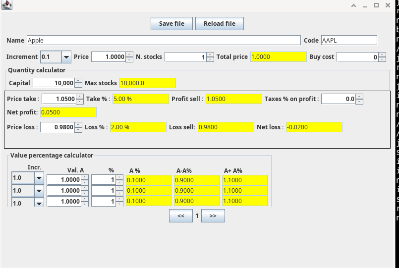

# Tradercalc

Simple utility for traders.
Simply calculate number of stocks, take profit and stop loss




# Compilazione
```
mvn clean package
```

# Creazione pacchetto linux

```
mkdir -p target/jpackage-input
cp target/tradecalc-*.jar target/jpackage-input/
mkdir -p dist/linux
```

Creazione applicazione autonoma

JAR=$(basename target/jpackage-input/tradecalc-*.jar)

jpackage \
    --type app-image \
    --name Tradecalc \
    --input target/jpackage-input \
    --main-jar "$JAR" \
    --main-class com.antoiovi.tradecalc.Tradecalc \
    --app-version 1.0 \
    --dest dist/linux

```

Avvio applicazione 

 ```
 ./dist/linux/Tradecalc/bin/Tradecalc
 ```

### Creazione pacchetto debian
```
sudo apt update
sudo apt install fakeroot dpkg-dev

jpackage \
    --type deb \
    --name tradecalc \
    --input target/jpackage-input \
    --main-jar "$JAR" \
    --main-class com.antoiovi.tradecalc.Tradecalc \
    --app-version 1.0 \
    --linux-shortcut \
    --dest dist/linux
```
### Creazione pacchetto windows

Da powershell :

```
mvn clean package

New-Item -ItemType Directory -Force target\jpackage-input

Copy-Item target\tradecalc-*.jar target\jpackage-input\

$jar = (Get-ChildItem target\jpackage-input\tradecalc-*.jar).Name
```